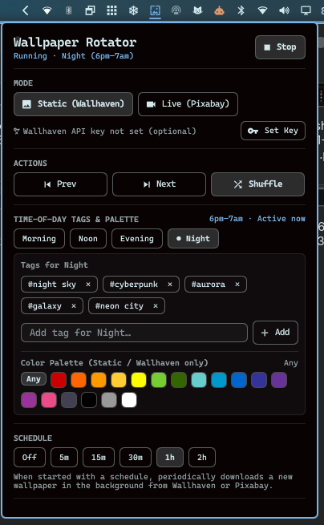

# Wallpaper Rotator (`ric-v.wallrotator`)

A system tray wallpaper manager and rotator for **any Linux desktop**: KDE Plasma, GNOME, XFCE, Cinnamon, MATE, LXQt, Budgie, Hyprland, sway, niri, i3, bspwm and more. It also ships as a native topbar plugin for [Omarchy](https://omarchy.org/) Shell.

<p align="center">
  
</p>

## Features

- **Two Modes**:
  - **Static (Wallhaven)**: High-resolution static wallpapers via Wallhaven (`https://wallhaven.cc/api/v1/search`), with optional per-period **color palette** filtering.
  - **Live (Pixabay)**: Muted, looping MP4 video wallpapers via Pixabay (`https://pixabay.com/api/videos/`). See [Live wallpapers](#live-wallpapers) for what each desktop supports.
- **Lives in the system tray**: left-click opens a settings popover next to the tray icon, middle-click shuffles, and right-click opens a menu with Start/Stop, Next, Prev, Shuffle, mode, schedule and recent wallpapers. The popover closes when you click elsewhere or press Esc; rotation keeps running in the tray.
- **Start / Stop & Auto-Rotation Schedule**: `Off`, `5m`, `15m`, `30m`, `1h` or `2h`.
- **Playback Actions**: **Prev** / **Next** / **Shuffle**.
- **Time-of-Day Tags & Color Palettes**: separate tag lists and optional Wallhaven color palettes for **Morning** (`7am–12pm`), **Noon** (`12pm–3pm`), **Evening** (`3pm–6pm`) and **Night** (`6pm–7am`), with curated defaults.
- **Recent 10 Wallpapers**: a thumbnail grid for one-click switching.
- **Built-In API Key Management**: set your **Wallhaven** key (optional) or **Pixabay** key (required for live videos) from the app. Keys are stored locally with `0600` permissions in `~/.local/state/wallrotator/`.
- **Auto-detects your desktop**, with a manual backend override in the window.
- **Start on login** toggle, plus command-line control for keybindings.

## Install: any Linux desktop (system tray app)

Requirements: `python3` and one Qt binding for Python (PySide6, PyQt6 or PyQt5).

| Distro | Qt binding |
| --- | --- |
| Arch / Manjaro | `sudo pacman -S pyside6` |
| Debian / Ubuntu / Mint | `sudo apt install python3-pyqt5` |
| Fedora | `sudo dnf install python3-pyside6` |
| openSUSE | `sudo zypper install python3-PySide6` |
| Any (pip) | `pip install --user PySide6-Essentials` |

Then:

```bash
git clone https://github.com/ric-v/omarchy-wallrotator.git
cd omarchy-wallrotator
./install.sh --autostart
wallrotator-tray
```

`install.sh` installs everything for your user only, with no root needed:

- the app goes to `~/.local/share/wallrotator/app`
- the launchers `wallrotator-tray` (tray) and `wallrotator` (CLI) go to `~/.local/bin`
- it adds an app menu entry
- with `--autostart`, it also adds a login entry

You can also run it straight from the checkout with `python3 wallrotator_tray.py`.

To uninstall, run `./install.sh --uninstall`. This keeps your state, API keys and downloaded wallpapers.

> **GNOME:** GNOME has no system tray by default. Install the *AppIndicator and KStatusNotifierItem Support* extension (Ubuntu ships it preinstalled). Without a tray, the app opens as a normal window that minimizes instead of closing.
>
> **Tiling WMs:** you need a bar with a tray, such as waybar (`"tray"` module), polybar, i3bar or the tray built into Hyprland/sway bars.
>
> **Popover on Wayland:** Wayland doesn't let apps choose where their windows appear, so the compositor places the popover (it opens floating, since it has a fixed size). To open it at the mouse pointer instead, add a window rule for the app id `wallrotator`. For example, in sway:
>
> ```
> for_window [app_id="wallrotator"] floating enable, move position cursor
> ```
>
> Hyprland has an equivalent `move` window rule (its exact syntax depends on your Hyprland version). On X11 the popover always opens right next to the tray icon.

### Wallpaper backends

The backend is detected automatically. You can override it in the window (**Desktop → Wallpaper backend**) or with the `WALLROTATOR_BACKEND` environment variable.

| Desktop | Backend | Tool used |
| --- | --- | --- |
| Omarchy | `omarchy` | `omarchy theme bg set` (+ `owe`) |
| GNOME, Budgie, Pantheon, Unity, Pop, Zorin | `gnome` | `gsettings` |
| Cinnamon | `cinnamon` | `gsettings` |
| MATE | `mate` | `gsettings` |
| KDE Plasma | `kde` | `plasma-apply-wallpaperimage` (or `qdbus`) |
| XFCE | `xfce` | `xfconf-query` |
| LXQt / LXDE | `lxqt` / `lxde` | `pcmanfm-qt` / `pcmanfm` |
| Hyprland | `swww`, `hyprpaper` or `swaybg` | `swww`/`awww`, `hyprctl hyprpaper` |
| sway | `swww`, `sway` or `swaybg` | `swww`/`awww`, `swaymsg` |
| Other Wayland (niri, river, wayfire, labwc…) | `swww` or `swaybg` | |
| X11 window managers (i3, bspwm, openbox, awesome…) | `feh`, `xwallpaper`, `nitrogen` or `hsetroot` | |

### Live wallpapers

Video wallpapers need a "live engine". The first one available is used:

- **Omarchy**: `owe`
- **Wayland compositors with layer-shell** (Hyprland, sway, niri, river, KDE Plasma Wayland…): [`mpvpaper`](https://github.com/GhostNaN/mpvpaper)
- **X11**: `xwinwrap` + `mpv`

If none is installed, or on GNOME Wayland (which has no layer-shell), the app sets a still frame of the video as a normal wallpaper. This needs `ffmpeg`. The window shows which engine is in use, and you can force one with `WALLROTATOR_LIVE_ENGINE=mpvpaper|xwinwrap|frame`.

Wallpapers downloaded on non-Omarchy desktops are saved in `~/.local/share/wallrotator/wallpapers`. You can change this with `WALLROTATOR_DIR`.

### Keybindings / command line

While the tray is running, these commands control it. Bind them in your desktop's keyboard settings or WM config:

```bash
wallrotator-tray toggle          # show/hide the window
wallrotator-tray next            # also: prev, shuffle
wallrotator-tray start           # also: stop, toggle-running
wallrotator-tray quit
```

`next`, `prev`, `shuffle`, `start` and `stop` still work when the tray is not running: they call the backend directly.

## Install: Omarchy (topbar plugin)

```bash
omarchy plugin add https://github.com/ric-v/omarchy-wallrotator.git --enable
```

To place it in the topbar tray drawer:

```bash
omarchy plugin enable ric-v.wallrotator --section tray
```

Keybindings in `~/.config/hypr/bindings.lua`:

```lua
o.bind("SUPER + CTRL + W", "Wallpaper Rotator", "omarchy-shell wallrotator toggle")
o.bind("SUPER + ALT + W", "Next wallpaper", "omarchy-shell wallrotator next")
```

Available IPC commands:
- `omarchy-shell wallrotator toggle` / `open` / `close`
- `omarchy-shell wallrotator next`
- `omarchy-shell wallrotator prev`
- `omarchy-shell wallrotator shuffle`
- `omarchy-shell wallrotator start` / `stop` / `toggleRunning`

Removal:

```bash
omarchy plugin disable ric-v.wallrotator
omarchy plugin remove ric-v.wallrotator
```

The plugin and the tray app share state, keys and history. Run only one of them with a schedule active, otherwise both will rotate.

To remove saved state, API keys and cached thumbnails:

```bash
rm -rf ~/.local/state/wallrotator ~/.cache/wallrotator
```

## Architecture

- `wallrotator.py`: desktop-agnostic backend. It uses only the Python standard library. Every command prints one JSON line (`status`, `next`, `prev`, `shuffle`, `apply`, `set-mode`, `set-schedule`, `set-running`, `set-backend`, …).
- `wallrotator_tray.py`: Qt system tray app for any desktop.
- `Panel.qml` + `manifest.json`: Omarchy Shell plugin.

## Testing & Validation

```bash
python3 -m unittest discover -s tests -v
omarchy plugin validate .     # Omarchy only
```

## Security & Privacy

- All UI text is rendered as plain text, and untrusted values are neutralized before display.
- Network requests are restricted to fixed HTTPS allowlists (`wallhaven.cc`, `w.wallhaven.cc`, `th.wallhaven.cc`, `pixabay.com`, `cdn.pixabay.com`, `i.vimeocdn.com`), with explicit timeouts and response size limits.
- Background rotation only fetches media when explicitly started with an active schedule.
- Wallpaper tools are always run without a shell. Tools that parse a command string (`swaymsg`, `hyprctl`) only ever receive paths made of safe characters; other paths are passed through a private symlink.
- Helper processes the app starts (`swaybg`, `mpvpaper`, `xwinwrap`) are tracked by PID and only stopped if the PID still belongs to that program.
- The tray's control socket lives in your private `$XDG_RUNTIME_DIR` and accepts only a fixed set of commands.

## License

[MIT License](LICENSE)
